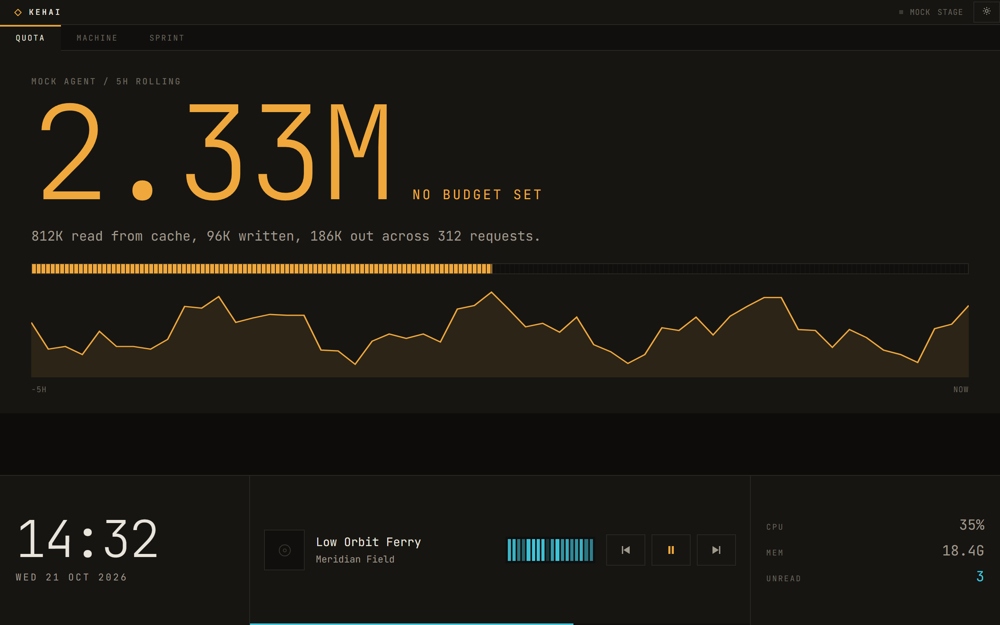
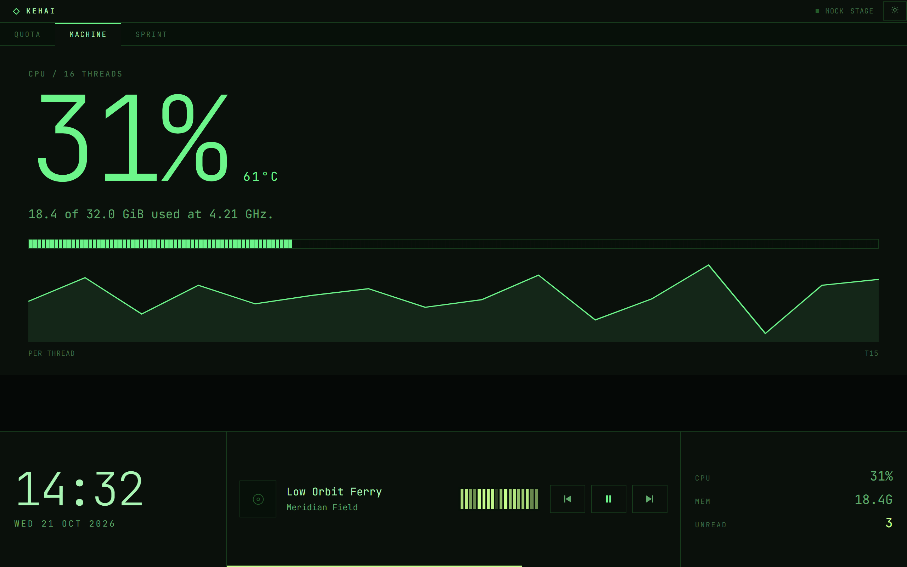
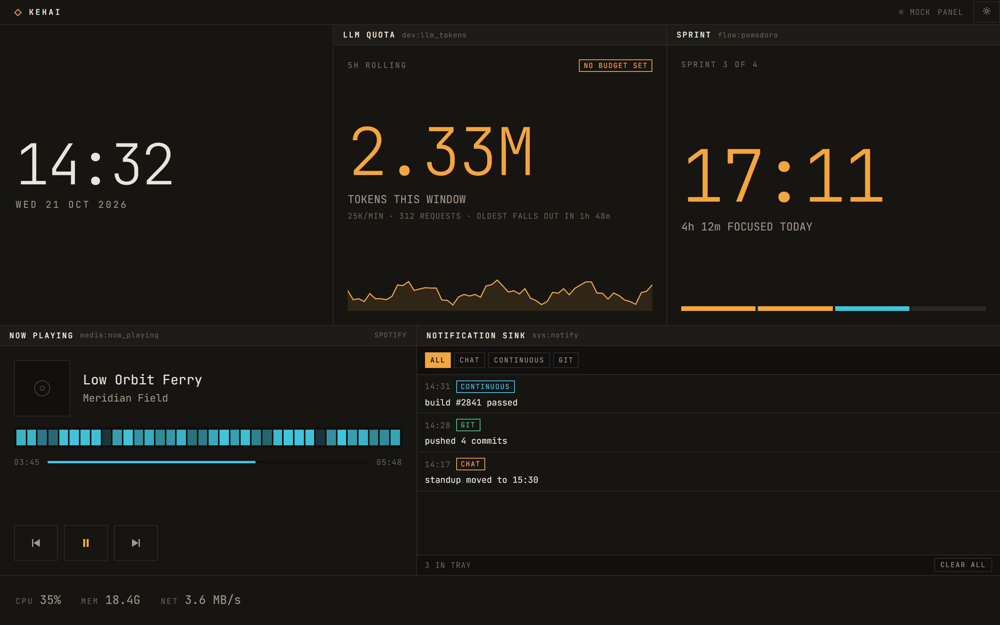
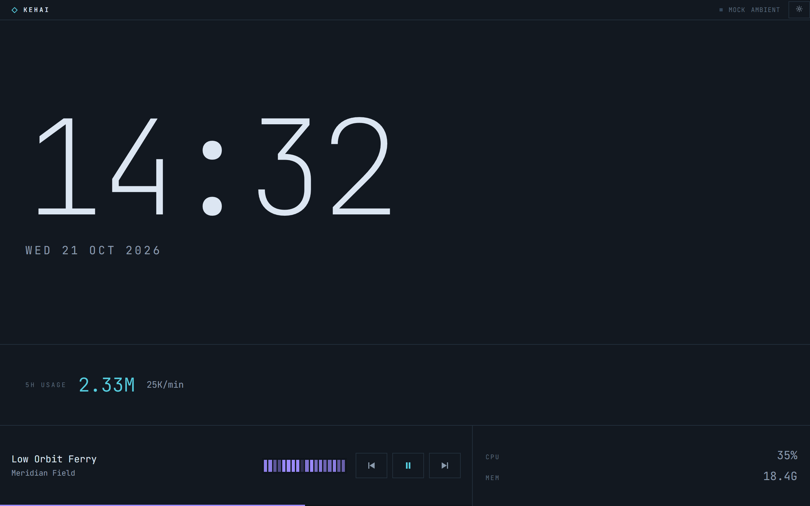
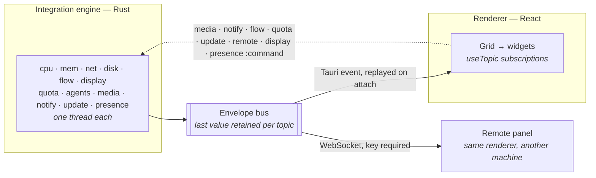

<h1 align="center">Kehai</h1>

<p align="center">
  <em>気配 — the sense that something is present, without having to look at it directly.</em>
</p>

<p align="center">
  A companion dashboard for a secondary display. System telemetry, coding agents and
  their token usage, media and notifications, in a terminal-inspired panel you read out
  of the corner of your eye.
</p>

<p align="center">
  <a href="https://github.com/Purukitto/kehai/actions/workflows/ci.yml"></a>
  <a href="https://github.com/Purukitto/kehai/releases/latest"></a>
  <a href="LICENSE"></a>
  
</p>

<p align="center">
  
</p>

---

Kehai is built for one specific thing: a small always-on display — a 10-inch
1280 × 800 panel on the corner of a desk — showing the handful of numbers you want to
know without switching windows to find them.

It is a [Tauri 2](https://tauri.app) desktop app. A Rust **integration engine** polls
system sources on background threads and pushes normalised events to the renderer; the
React front end is a pure consumer that lays widgets out on a CSS grid. Nothing in the
UI can call an API, and no reading is ever sent anywhere.

## Download

Grab an installer from the [latest release](https://github.com/Purukitto/kehai/releases/latest):

| File | What it is |
| --- | --- |
| `Kehai_x.y.z_x64-setup.exe` | NSIS installer. The usual choice. |
| `Kehai_x.y.z_x64_en-US.msi` | MSI, for policy-managed or scripted installs. |
| `kehai-x.y.z-windows-x64-portable.zip` | A single `kehai.exe`. No install, no uninstaller, no self-update. |

Windows 10 1803 or newer, x64. Kehai uses the system WebView2 runtime, which ships
with Windows 11 and current Windows 10 — on an older machine the installer offers to
fetch it.

The binaries are unsigned, so SmartScreen warns on first launch. Building from source
takes about five minutes if you would rather not trust a stranger's exe.

### Updating

An installed copy updates itself. **Settings → About → Check** asks
GitHub for the latest release, shows what changed, and **Install** closes Kehai,
runs the new installer and opens it again. Turn on **Check automatically** to have
it look once a day; it is off until you do.

Every update is signed, and Kehai refuses one whose signature does not match the key
built into it. The portable build cannot replace itself, so it links to the release
page instead.

## Using it

The first time it opens, Kehai runs a short setup. It asks which display it is for and
moves there as soon as you choose, so the rest of setup happens on the panel itself:
what it can read on this machine, notifications included, then the layout and colours,
drawn for that display. **Skip setup** opens the panel as it is, and
**Settings → About → Run setup again** brings setup back. A copy updated from 0.6 or
earlier skips it.

| Key | Does |
| --- | --- |
| `S` | Open and close settings |
| `Esc` | Back to the dashboard |
| `F11` | Fullscreen |

The layout's name in the header switches layout: tap it for a list, or on a
touchscreen swipe sideways along the header for the next or previous one. Nothing on
the panel you can press is smaller than 28px, so a touchscreen needs no mode of its own.

The window is undecorated and draws its own title bar; drag it by the top strip.
**Settings → Window** shows your displays as the system arranges them: tap one and
Kehai moves there, filling it or in a window. It reopens on that display, and if the
display is not connected it opens in a window on the main one instead, says so in the
header, and moves back by itself once the display returns. Dragging it onto another
display makes that the one it is for. The same page turns on autostart and the
auto-hiding top bar.

**Settings → Appearance** turns everything Kehai draws down at night, between two
times you set, and decides what the panel shows while nobody is at the computer. After
a while with no keyboard, mouse or touch it goes quiet: the time, dim, and only what
is running or waiting on you, with notifications as a count and never their text. It
can stay as it is instead, dimmed with notification text hidden, or go dark until an
agent waits. A touch or a nudge of the mouse brings it back, and the first tap only
wakes it, so it never presses a button you could not see. While Windows is locked its
lock screen covers every display, and Kehai stops drawing. Setup turns both on; a copy
that already had settings keeps both off until you turn them on.

Three presets ship — **Stage** (default), **Panel** and **Ambient** — each arranged
three ways: for a landscape panel, a bar display and a portrait screen. Kehai shows
the arrangement that fits its window, so the same layout works on a 16:10 panel, a
1920 × 480 bar and a tablet on its end.

**Settings → Layout** lists the presets and the layouts of your own. **Arrange** opens
a direct-manipulation grid editor, one tab per shape: drag a tile to move it, drag its
corner to resize, drop it onto another tile to swap the two. Presets themselves never
change; the first change to one saves a copy under **Yours**. Export and Import write
a layout as JSON if you want to commit or share one.

<p align="center">
  
  
  
  <br>
  <sub>Stage in Phosphor · Panel in Amber · Ambient in Ice. Any preset takes any theme.</sub>
</p>

### Widgets

| Key | Called | Shows | Reads |
| --- | --- | --- | --- |
| `stage` | Main readout | One large reading with tabs for tokens, agents, machine and focus. Moves to Agents while one waits on you | tokens, agents, CPU, memory, timer |
| `telemetry` | Machine | CPU history, memory, network, volumes | all four telemetry topics |
| `vitals` | Status strip | CPU, memory, network, unread and agents in a line | CPU, memory, network, notifications, agents |
| `agents` | Agents | Which agent sessions are working and which are waiting on you | `dev:agents` |
| `quota` | Token usage | Agent tokens in the current 5-hour block, and when it resets | `dev:llm_tokens` |
| `media` | Now playing | Track, transport, seek, cover art and this computer's volume | `media:now_playing`, `media:art`, `media:volume` |
| `notify` | Notifications | System notification feed, dismissable | `sys:notify` |
| `clock` | Clock | Time and date; hours over minutes in a tall tile | `os:clock` |
| `sprint` | Focus timer | Start, pause, skip, reset | `flow:pomodoro` |

### Sources

| Source | Windows | Linux | macOS |
| --- | --- | --- | --- |
| CPU, memory, network, disk | via `sysinfo` | via `sysinfo` | via `sysinfo` |
| CPU package temperature | usually unavailable — see below | label varies | label varies |
| Media session, transport and seek | via GSMTC, including cover art | via MPRIS; cover art only from local files | not wired |
| System volume | the default output, as the volume keys turn it | not wired | not wired |
| Notifications | via `UserNotificationListener` | via a session-bus monitor; only those that arrive while Kehai runs | not wired |
| Agent token usage | optional — needs local agent transcripts | same | same |
| Agent sessions | optional — the same transcripts | same | same |
| Focus timer | kept by the engine | same | same |
| Whether you are at the computer | time since the last input, and the lock | not wired | not wired |

Where a source is unavailable the widget says so, and Settings → Sources shows it as
**UNAVAILABLE** with the reason. Nothing shows a zero it does not have — see
[Design notes](docs/design.md). The Stage preset drops a tab whose source has
nothing to report rather than leaving it blank.

<details>
<summary><strong>Why CPU temperature is usually missing on Windows</strong></summary>

CPU die temperature lives in model-specific registers — the digital thermal sensor
on Intel, Tctl on AMD — and reading one takes the `rdmsr` instruction, which only
kernel mode can execute. The two routes Windows offers ordinary processes are an
ACPI thermal zone, which needs elevation and on many desktops reports a chassis
zone or nothing at all, and `Win32_TemperatureProbe`, which almost no hardware
populates.

Tools like HWMonitor and HWiNFO get around this by installing a kernel driver.
Kehai deliberately does not: a driver needs administrator rights to install, and
generic MSR-access drivers have a history of letting unprivileged code read and
write hardware registers. That is a poor trade for one number on a dashboard.

</details>

### Remote panel

The display does not have to hang off the machine being watched. Turn on
**Settings → Remote** and Kehai serves the panel to a browser on another machine on
the same network — an old laptop, a tablet, a Raspberry Pi driving the 10-inch
screen.

Under **Pair a tablet or phone**, press **Show code** and scan it with the other
device's camera, or copy the link. Either pairs by itself: the link carries a key,
which the remote panel keeps and takes out of the address bar. The code holds the key
too, so it stays covered until you ask for it and covers itself again after two
minutes or when Settings closes. Settings lists this machine's network addresses with
real adapters first; a virtual one, such as WSL's, is marked, since nothing else on
the network can reach it. A device where opening a link is awkward can paste the link
or the key into the prompt instead. **New key** cuts off every remote panel at once.

A remote panel has its own layout and theme, kept in its own browser. It only reads
unless **Allow control** is on, and even then it can only press the buttons the panel
has — play, skip and seek, the volume, dismiss a notification, start or pause the focus timer. It can
never change a setting, name a file or start an update. The header says `REMOTE`,
`REMOTE · VIEW ONLY`, or why it is not connected. When the host stops answering —
asleep, off, or off the network — every tile dims and the header says since when, so
an old reading never passes for a live one. The panel comes back by itself.

The same port answers to scripts, with the key as a bearer token:

```bash
curl -H "Authorization: Bearer $KEY" http://192.168.1.20:5280/api/topics
```

| Route | Does |
| --- | --- |
| `GET /api/topics` | Every topic's last envelope, by topic |
| `GET /api/topics/<topic>` | One topic's last envelope, e.g. `/api/topics/telemetry:cpu` |
| `POST /api/command/<topic>` | A command a remote panel could send, as JSON — `{"action":"start"}` to `flow:command` — when control is on |
| `ws://…/bus` | The live bus. Send `{"type":"hello","key":"…"}` first |

It is plain HTTP, so the key and everything the panel shows, notifications included,
cross your network unencrypted. Use it on a network you trust.

## Privacy

Kehai reads local sources and publishes them to its own in-process bus. Nothing it
reads is uploaded, logged to disk or phoned home. The one thing it writes is how long
the focus timer has run today, to `flow.json` in its own app-data folder, so the total
survives a restart; which display it is for, beside it in `display.json`; and, once you
turn on the remote panel, the key for it, in `remote.json`.

The font is built in, so Kehai makes one kind of network request, and the renderer's
content-security policy forbids anything else: **the update check**, and only when you
press Check or turn on Check automatically. It fetches `latest.json` from this
repository's latest GitHub release, which tells GitHub your IP address and that some
copy of Kehai asked — nothing more. Installing downloads the installer from the same
release.

It listens for nothing unless you turn on **Settings → Remote**. Then it accepts
connections on one port from your network, and shows the panel's data only to a
device holding the key. While it serves, it also announces itself on your local
network over mDNS, the way printers and speakers are found: this computer's name and
the port, never the key, so a paired tablet can find it again after the router hands
it a new address. The pairing link and code carry the same name. Turn the remote panel
off and the announcement stops.

Four sources are worth stating plainly:

- **Notifications.** Kehai reads none until you press **Allow**, in setup, on the tile
  or under Settings → Sources. On Windows the app then registers as a notification
  listener, which means it can read the title and body of toasts from any app, and
  Windows asks you to confirm. Deny it and the widget reports the refusal rather than
  showing an empty feed. On Linux nothing more prompts: Kehai asks the session bus to copy it every
  notification on its way to the notification server, the id the server gives it and
  word of it closing, and nothing else — the same access `dbus-monitor` uses, which
  any program running as you already has.
- **Agent token usage.** The quota widget tallies token counts by tailing local coding
  agent session transcripts — under `~/.claude/projects` unless you point
  Settings → Sources at another folder — reading file modification times, and the usage
  counters and reply ids on assistant turns so each reply counts once. No prompt or
  response text is read, retained or displayed. There is no API call and no account
  involved; if the folder does not exist or holds no transcripts, the source reports
  itself unavailable and the rest of the panel is unaffected.

  Usage is counted per 5-hour block: one opens with the first request after the last
  one closed, on the hour before it, and the widget shows when it resets. The provider
  does not publish how its window works, so that time is an estimate worked out from
  the transcripts, the same way other local usage tools do it.
- **Whether you are at the computer.** For the quiet panel, the engine asks Windows
  once a second how long it has been since the last keyboard, mouse, pen or touch
  input, and whether the session is locked: a duration and a yes or no, never what was
  pressed or where. Neither is kept, and neither reaches a remote panel.
- **Agent sessions.** The agents widget reads the same transcripts for how each one
  ends: whether the last reply finished, which tool calls are still open, when, and the
  folder the session works in. It does not parse or keep what you or the model wrote.
  To tell a reply that finished from a turn you cut short or a command that never
  reached the model, it matches a few fixed markers the agent itself writes in your
  place, such as the note it leaves when you interrupt it. The folder's name is shown
  on the panel, and on a remote panel too.

  A tool call that has not returned shows as **TOOL**. That is also all a permission
  prompt looks like, because nothing is written until it is answered, so Kehai lights
  one that has been open for half a minute but never claims it is waiting on you.

## Building from source

Requires [Bun](https://bun.sh), a [Rust](https://rustup.rs) toolchain (1.85 or newer)
and, on Windows, the MSVC build tools that `rustup` sets up. See
[Tauri's prerequisites](https://tauri.app/start/prerequisites/) for the full list.

```bash
bun install
```

```bash
bun run dev
```

That serves the renderer on <http://localhost:5273> with a mock source driving every
widget — the header reads `MOCK`. All widget and layout work can be done there, in a
browser, with no Rust in the loop.

For the desktop app:

```bash
bun run tauri:build
```

The result is `src-tauri/target/release/kehai.exe` with the frontend embedded, plus
installers under `src-tauri/target/release/bundle/`. Under Tauri the Rust engine takes
over the topics it can source and the header reads `ENGINE` with a green dot, so which
source is live is visible rather than assumed.

<details>
<summary><strong>Debug builds behave differently on purpose</strong></summary>

`main.rs` gates `windows_subsystem = "windows"` on `not(debug_assertions)`, so a
**debug build is console-subsystem**: it keeps a terminal, prints every poller's
diagnostics to it, and exits when that terminal is closed. That is the point of it.
Release is GUI-subsystem and silent.

A bare `cargo build` additionally loads the frontend from the Vite dev server instead
of the embedded bundle — convenient while iterating, useless once that server stops.
Anything about how Kehai behaves as an installed, autostarted app has to be tested
against a release build.

</details>

### Scripts

| Command | Does |
| --- | --- |
| `bun run dev` | Vite on :5273 (`strictPort`, so it fails rather than moving) |
| `bun run build` | Typecheck and build the renderer into `dist/` |
| `bun run typecheck` | Typecheck only |
| `bun run tauri:dev` | Desktop shell against the dev server |
| `bun run tauri:build` | Release build and installers |
| `bun run release <patch\|minor\|major\|x.y.z>` | Bump the version, roll the changelog, commit and tag — see [Releasing](CONTRIBUTING.md#releasing) |

## Architecture



Everything on the bus is one shape:

```json
{ "topic": "telemetry:cpu", "ts": 1755781234567, "src": "poller.cpu", "data": {} }
```

Widgets subscribe to the topics they need and nothing else — no props thread through
the tree. **Both** buses retain the last value per topic: the renderer's so a
late-mounted widget renders immediately instead of booting blank, and the engine's
because Tauri events are fire-and-forget, so a publish-on-change source would otherwise
stay silent forever after one missed send. The renderer emits `ui:hello` once
subscribed and the engine replays every retained topic in reply.

Each poller owns one thread, so a stalled source can only stall itself. The renderer is
read-only except for eight command topics — `media:command`, `notify:command`,
`flow:command`, `quota:command`, `update:command`, `remote:command`,
`display:command` and `presence:command`: the UI states
an intent, the engine owns the side effect and runs it off the event thread, so a
wedged media player cannot freeze the panel and a slow download cannot either.

A remote panel is the same renderer, served by the engine and fed by a WebSocket
instead of the Tauri bridge. It can forward the first three of those commands, and
only while the host allows control; the engine checks every one again.

### Where things are

| Path | What |
| --- | --- |
| `src/core/bus.ts` | Pub/sub with last-value retention and wildcard topics |
| `src/core/mockSource.ts` | Stand-in for the engine — publishes the real topics |
| `src/core/tauriSource.ts` | Bridges engine events onto the bus, both directions |
| `src/core/remoteSource.ts` | The same, for a remote panel, over a WebSocket |
| `src/core/payloads.ts` | Every payload shape, mirrored by hand from Rust |
| `src/core/layout.ts` | Validates a stored or imported layout, in either format |
| `src/core/useWindowShape.ts` | Picks landscape, bar or portrait from the window |
| `src/core/settings.tsx` | The settings store and everything that persists |
| `src/setup/Setup.tsx` | First-run setup: display, sources, layout, the last few choices |
| `src/components/DisplayMap.tsx` | The displays as the system arranges them, for setup and Settings |
| `src/grid/Grid.tsx` | Renders a layout onto a CSS grid |
| `src/grid/Arranger.tsx` | The tile arranger |
| `src/widgets/` | One module per widget, each declaring its topics and minimum size |
| `src/widgets/registry.ts` | The only way a widget is reached |
| `src/layouts/*.layout.json` | The three shipped presets |
| `src/styles/tokens.css` | Thirteen custom properties per theme |
| `src-tauri/src/bus.rs` | Mints envelopes, retains them, emits them |
| `src-tauri/src/pollers/` | One thread per source |
| `src-tauri/src/pollers/transcripts.rs` | Finds and follows agent transcripts, for the quota and agents pollers |
| `src-tauri/src/pollers/update.rs` | Checks GitHub Releases and hands over to the installer |
| `src-tauri/src/pollers/display.rs` | Keeps the window on the display it is for, and names the displays |
| `src-tauri/src/pollers/presence.rs` | Says whether anyone is at the computer, for the quiet panel |
| `src-tauri/src/remote.rs` | Serves the panel, the bus and the API to other machines |
| `scripts/release.ts` | Cuts a release: version, changelog, commit, tag |

[Design notes](docs/design.md) covers the reasoning behind the presets, the theme
system and the "UI only consumes" rule. [CONTRIBUTING.md](CONTRIBUTING.md) covers
adding a widget or a poller.

## Not built yet

- HTTPS for the remote panel, so it can be used on a network you do not trust
- Media and notifications on macOS, which keeps both behind private frameworks
- Code signing, so installers stop tripping SmartScreen

## Licence

[MIT](LICENSE) © Pulkit Sambhavi Singh

The bundled [JetBrains Mono](https://www.jetbrains.com/lp/mono/) typeface is © JetBrains
and distributed under the [SIL Open Font License 1.1](https://openfontlicense.org).
