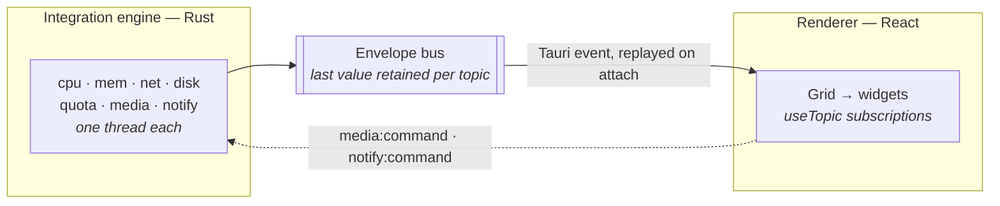

<h1 align="center">Kehai</h1>

<p align="center">
  <em>気配 — the sense that something is present, registered without looking at it directly.</em>
</p>

<p align="center">
  A companion dashboard for a secondary display. System telemetry, agent token usage,
  media and notifications, in a terminal-inspired panel you read out of the corner of
  your eye.
</p>

<p align="center">
  <a href="https://github.com/Purukitto/kehai/actions/workflows/ci.yml"></a>
  <a href="https://github.com/Purukitto/kehai/releases/latest"></a>
  <a href="LICENSE"></a>
  
</p>

---

Kehai is built for one specific thing: a small always-on display — a 10-inch
1280 × 800 panel on the corner of a desk — showing the handful of numbers you want to
know without switching windows to find them.

It is a [Tauri 2](https://tauri.app) desktop app. A Rust **integration engine** polls
system sources on background threads and pushes normalised events to the renderer; the
React front end is a pure consumer that lays widgets out on a CSS grid. Nothing in the
UI can call an API, and no reading is ever sent anywhere.

## Download

Grab an installer from the [latest release](https://github.com/Purukitto/kehai/releases/latest):

| File | What it is |
| --- | --- |
| `Kehai_x.y.z_x64-setup.exe` | NSIS installer. The usual choice. |
| `Kehai_x.y.z_x64_en-US.msi` | MSI, for policy-managed or scripted installs. |
| `kehai-x.y.z-windows-x64-portable.zip` | A single `kehai.exe`. No install, no uninstaller. |

Windows 10 1803 or newer, x64. Kehai uses the system WebView2 runtime, which ships
with Windows 11 and current Windows 10 — on an older machine the installer offers to
fetch it.

The binaries are unsigned, so SmartScreen warns on first launch. Building from source
takes about five minutes if you would rather not trust a stranger's exe.

## Using it

| Key | Does |
| --- | --- |
| `S` | Open and close settings |
| `Esc` | Back to the dashboard |
| `F11` | Fullscreen |

The window is undecorated and draws its own title bar; drag it by the top strip.
**Settings → Window** turns on autostart and the auto-hiding top bar, and position and
size are restored per display, so the panel reopens where you left it.

Three presets ship — **Stage** (default), **Panel** and **Ambient** — and
**Settings → Arrange** is a direct-manipulation grid editor: drag a tile to move it,
drag its corner to resize, drop it onto another tile to swap the two. Export and Import
write the layout as JSON if you want to commit or share one.

### Widgets

| Key | Widget | Reads |
| --- | --- | --- |
| `stage` | Hero readout with a tab strip | tokens, CPU, memory, timer |
| `telemetry` | CPU history, memory, network, volumes | all four telemetry topics |
| `vitals` | Compact CPU / memory / network strip | CPU, memory, network |
| `quota` | Agent token usage over a rolling window | `dev:llm_tokens` |
| `media` | Now playing, transport and cover art | `media:now_playing`, `media:art` |
| `notify` | System notification feed, dismissable | `sys:notify` |
| `clock` | Time and date | `os:clock` |
| `sprint` | Pomodoro timer | `flow:pomodoro` |

### Sources

| Source | Windows | Linux / macOS |
| --- | --- | --- |
| CPU, memory, network, disk | via `sysinfo` | via `sysinfo` |
| CPU package temperature | needs a vendor driver, else reported as no sensor | label varies by platform |
| Media session and transport | via GSMTC, including cover art | MPRIS not wired yet |
| Notifications | via `UserNotificationListener` | D-Bus not wired yet |
| Agent token usage | yes | yes |

Where a source is unavailable the widget says so. It never shows a zero it does not
have — see [Design notes](docs/design.md).

## Privacy

Kehai reads local sources and publishes them to its own in-process bus. **It makes no
network requests at all** beyond the web font the renderer loads, and its
content-security policy forbids everything else. Nothing is uploaded, logged to disk
or phoned home.

Two sources are worth stating plainly:

- **Notifications.** On Windows the app registers as a notification listener, which
  means it can read the title and body of toasts from any app. Windows prompts for this
  the first time. Deny it and the widget reports the refusal rather than showing an
  empty feed.
- **Agent token usage.** The quota widget tallies token counts by tailing local coding
  agent session transcripts under `~/.claude/projects` — file modification times and
  the usage counters on assistant turns. No prompt or response text is read, retained
  or displayed. There is no API call and no account involved; if the directory does not
  exist the source stays empty.

## Building from source

Requires [Bun](https://bun.sh), a [Rust](https://rustup.rs) toolchain (1.85 or newer)
and, on Windows, the MSVC build tools that `rustup` sets up. See
[Tauri's prerequisites](https://tauri.app/start/prerequisites/) for the full list.

```bash
bun install
```

```bash
bun run dev
```

That serves the renderer on <http://localhost:5273> with a mock source driving every
widget — the header reads `MOCK`. All widget and layout work can be done there, in a
browser, with no Rust in the loop.

For the desktop app:

```bash
bun run tauri:build
```

The result is `src-tauri/target/release/kehai.exe` with the frontend embedded, plus
installers under `src-tauri/target/release/bundle/`. Under Tauri the Rust engine takes
over the topics it can source and the header reads `ENGINE` with a green dot, so which
source is live is visible rather than assumed.

<details>
<summary><strong>Debug builds behave differently on purpose</strong></summary>

`main.rs` gates `windows_subsystem = "windows"` on `not(debug_assertions)`, so a
**debug build is console-subsystem**: it keeps a terminal, prints every poller's
diagnostics to it, and exits when that terminal is closed. That is the point of it.
Release is GUI-subsystem and silent.

A bare `cargo build` additionally loads the frontend from the Vite dev server instead
of the embedded bundle — convenient while iterating, useless once that server stops.
Anything about how Kehai behaves as an installed, autostarted app has to be tested
against a release build.

</details>

### Scripts

| Command | Does |
| --- | --- |
| `bun run dev` | Vite on :5273 (`strictPort`, so it fails rather than moving) |
| `bun run build` | Typecheck and build the renderer into `dist/` |
| `bun run typecheck` | Typecheck only |
| `bun run tauri:dev` | Desktop shell against the dev server |
| `bun run tauri:build` | Release build and installers |

## Architecture



Everything on the bus is one shape:

```json
{ "topic": "telemetry:cpu", "ts": 1755781234567, "src": "poller.cpu", "data": {} }
```

Widgets subscribe to the topics they need and nothing else — no props thread through
the tree. **Both** buses retain the last value per topic: the renderer's so a
late-mounted widget renders immediately instead of booting blank, and the engine's
because Tauri events are fire-and-forget, so a publish-on-change source would otherwise
stay silent forever after one missed send. The renderer emits `ui:hello` once
subscribed and the engine replays every retained topic in reply.

Each poller owns one thread, so a stalled source can only stall itself. Widgets are
read-only except for `media:command` and `notify:command`: the widget states an intent,
the engine owns the side effect and runs it off the event thread, so a wedged media
player cannot freeze the panel.

### Where things are

| Path | What |
| --- | --- |
| `src/core/bus.ts` | Pub/sub with last-value retention and wildcard topics |
| `src/core/mockSource.ts` | Stand-in for the engine — publishes the real topics |
| `src/core/tauriSource.ts` | Bridges engine events onto the bus, both directions |
| `src/core/payloads.ts` | Every payload shape, mirrored by hand from Rust |
| `src/core/layout.ts` | Validates a stored or imported layout |
| `src/core/settings.tsx` | The settings store and everything that persists |
| `src/grid/Grid.tsx` | Renders a layout onto a CSS grid |
| `src/grid/Arranger.tsx` | The tile arranger |
| `src/widgets/` | One module per widget, each declaring its topics and minimum size |
| `src/widgets/registry.ts` | The only way a widget is reached |
| `src/layouts/*.layout.json` | The three shipped presets |
| `src/styles/tokens.css` | Thirteen custom properties per theme |
| `src-tauri/src/bus.rs` | Mints envelopes, retains them, emits them |
| `src-tauri/src/pollers/` | One thread per source |

[Design notes](docs/design.md) covers the reasoning behind the presets, the theme
system and the "UI only consumes" rule. [CONTRIBUTING.md](CONTRIBUTING.md) covers
adding a widget or a poller.

## Not built yet

- The headless WebSocket/REST surface, for driving a panel from another machine
- Linux media (MPRIS) and notifications (D-Bus) — currently report unavailable
- JetBrains Mono is loaded from Google Fonts and needs vendoring before the desktop
  build can claim to work offline
- Code signing, so installers stop tripping SmartScreen

## Licence

[MIT](LICENSE) © Pulkit Sambhavi Singh
