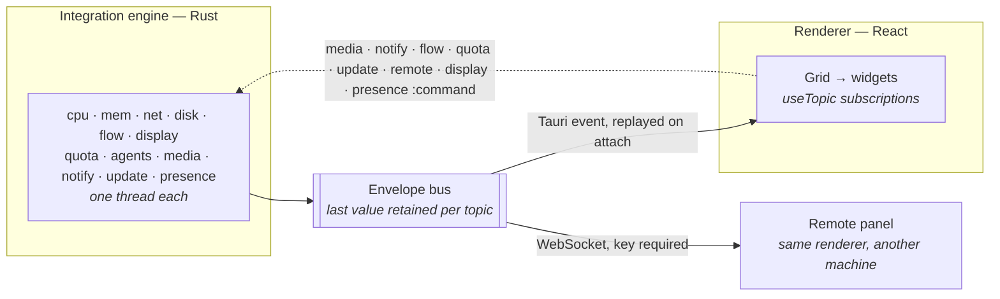

# Architecture

[Documentation](README.md) › Architecture

Kehai is a [Tauri 2](https://tauri.app) desktop app. A Rust **integration engine**
polls system sources on background threads and pushes normalised events to the
renderer; the React front end is a pure consumer that lays widgets out on a CSS grid.
Nothing in the UI can call an API, and no reading is ever sent anywhere.

- [Overview](#overview)
- [The bus](#the-bus)
- [Commands](#commands)
- [Where things are](#where-things-are)

## Overview



## The bus

Everything on the bus is one shape:

```json
{ "topic": "telemetry:cpu", "ts": 1755781234567, "src": "poller.cpu", "data": {} }
```

Widgets subscribe to the topics they need and nothing else — no props thread through
the tree. **Both** buses retain the last value per topic: the renderer's so a
late-mounted widget renders immediately instead of booting blank, and the engine's
because Tauri events are fire-and-forget, so a publish-on-change source would otherwise
stay silent forever after one missed send. The renderer emits `ui:hello` once
subscribed and the engine replays every retained topic in reply.

## Commands

Each poller owns one thread, so a stalled source can only stall itself. The renderer is
read-only except for eight command topics — `media:command`, `notify:command`,
`flow:command`, `quota:command`, `update:command`, `remote:command`,
`display:command` and `presence:command`. The UI states an intent; the engine owns the
side effect and runs it off the event thread, so a wedged media player cannot freeze
the panel and a slow download cannot either.

A remote panel is the same renderer, served by the engine and fed by a WebSocket
instead of the Tauri bridge. It can forward the first three of those commands, and
only the actions the panel has buttons for, while the host allows control; the engine
checks every one again.

## Where things are

| Path | What |
| --- | --- |
| `src/core/bus.ts` | Pub/sub with last-value retention and wildcard topics |
| `src/core/mockSource.ts` | Stand-in for the engine — publishes the real topics |
| `src/core/tauriSource.ts` | Bridges engine events onto the bus, both directions |
| `src/core/remoteSource.ts` | The same, for a remote panel, over a WebSocket |
| `src/core/payloads.ts` | Every payload shape, mirrored by hand from Rust |
| `src/core/layout.ts` | Validates a stored or imported layout, in either format |
| `src/core/useWindowShape.ts` | Picks landscape, bar or portrait from the window |
| `src/core/settings.tsx` | The settings store and everything that persists |
| `src/setup/Setup.tsx` | First-run setup: display, sources, layout, the last few choices |
| `src/components/DisplayMap.tsx` | The displays as the system arranges them, for setup and Settings |
| `src/components/QrCode.tsx` | The pairing code in Settings → Remote |
| `src/components/Stale.tsx` | What a remote panel shows over its tiles when the host goes away |
| `src/grid/Grid.tsx` | Renders a layout onto a CSS grid |
| `src/grid/Arranger.tsx` | The tile arranger |
| `src/widgets/` | One module per widget, beside its description file, `<id>.widget.json` |
| `src/widgets/registry.ts` | The only way a widget is reached |
| `src/core/widget.ts` | Validates a widget's description file: name, minimum size, the sources it reads |
| `src/core/sources.ts` | The sources widgets read, and the topics each publishes on |
| `src/layouts/*.layout.json` | The three shipped presets |
| `src/styles/tokens.css` | Thirteen custom properties per theme |
| `src-tauri/src/bus.rs` | Mints envelopes, retains them, emits them |
| `src-tauri/src/pollers/` | One thread per source |
| `src-tauri/src/pollers/media.rs` | Now playing, seek and the system volume |
| `src-tauri/src/pollers/transcripts.rs` | Finds and follows agent transcripts, for the quota and agents pollers |
| `src-tauri/src/pollers/update.rs` | Checks GitHub Releases and hands over to the installer |
| `src-tauri/src/pollers/display.rs` | Keeps the window on the display it is for, and names the displays |
| `src-tauri/src/pollers/presence.rs` | Says whether anyone is at the computer, for the quiet panel |
| `src-tauri/src/remote.rs` | Serves the panel, the bus and the API to other machines, and announces it |
| `scripts/release.ts` | Cuts a release: version, changelog, commit, tag |

The reasoning behind the presets, the theme system and the "UI only consumes" rule is
in the [design notes](design.md). [CONTRIBUTING.md](../CONTRIBUTING.md) covers adding a
widget or a poller.
